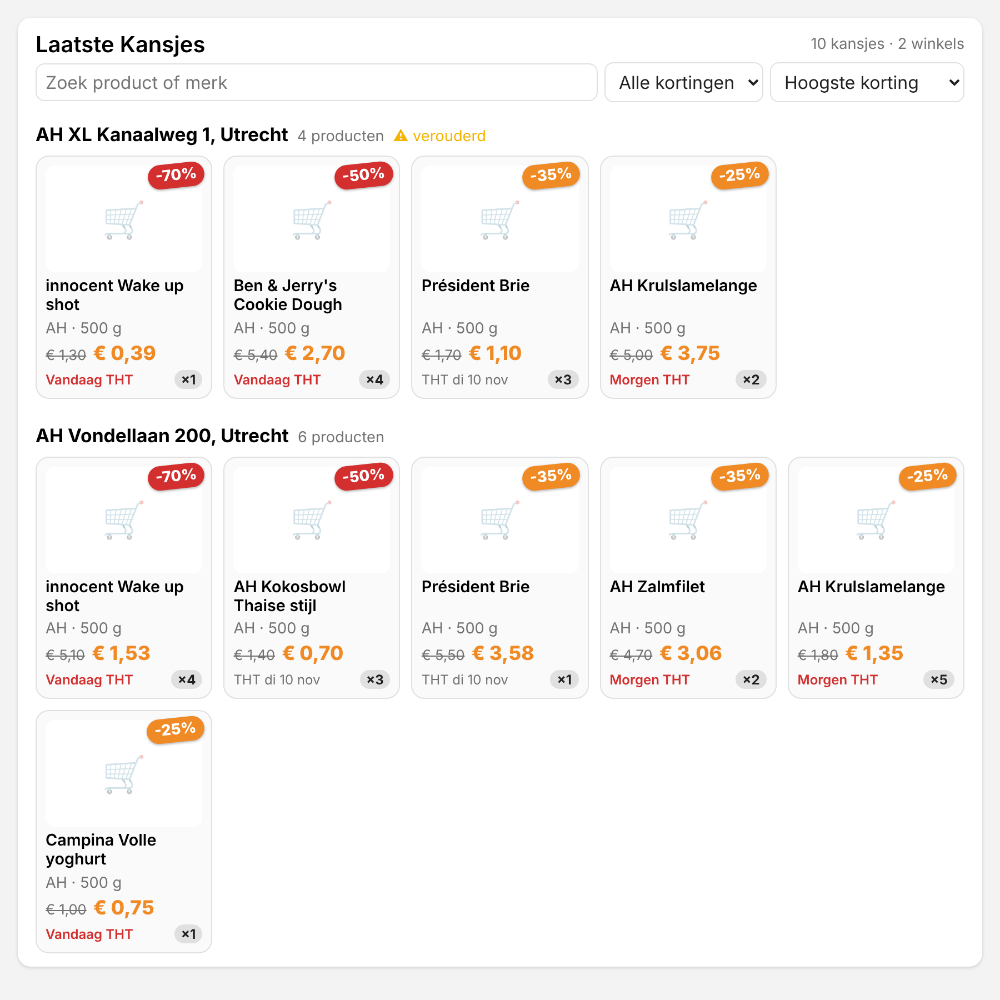

# 🏠 AH Laatste Kans voor Home Assistant

Een custom integration die de **Albert Heijn Laatste Kans**-stickers van je winkels in Home Assistant zet,
met een eigen dashboard-card.

> ⚠️ Onofficieel: de integratie gebruikt de niet-openbare API van de AH-app. AH kan die op elk moment wijzigen.



## Wat je krijgt

| Entiteit | State | Attributen |
|---|---|---|
| `sensor.ah_<straat>_<nr>_<plaats>_laatste_kans` (één per winkel, elk een eigen apparaat) | aantal producten | `items` (titel, merk, prijs, oude prijs, korting, voorraad, THT, plaatje, link), `best_discount`, `categories`, adres |
| `sensor.ah_laatste_kans_laatste_kans_totaal` (of `_total`) | totaal over alle winkels | `top`: de 10 beste deals |
| `sensor.ah_laatste_kans_laatste_kans_volglijst` (of `_watchlist`) | aantal treffers op je volglijst | `keywords`, `matches` |
| `select.ah_laatste_kans_laatste_kans_winkel` (of `_store`) | gekozen winkel voor de card | `options`: *Alle winkels* + je winkels |

En een **event** `ah_laatste_kans_new_bargain` voor elk product dat er sinds de vorige update bij is gekomen.
Producten op je volglijst geven ook één keer een event als ze er al lagen, bijvoorbeeld meteen nadat je de
volglijst hebt opgeslagen. Daarna niet meer, ook niet na een herstart.

De Engelse namen (`_total`, `_watchlist`, `_store`) krijg je als Home Assistant in het Engels stond toen je de integratie
installeerde.

**Waarom één sensor per winkel (en niet per product)?** Laatste Kans-producten wisselen dagelijks. Sensoren per
product zouden steeds verschijnen en verdwijnen en je entity-register vervuilen. Eén sensor per winkel heeft een
stabiele naam, en de productlijst staat in een attribuut. Die lijst is al snel groter dan de 16 KB die de recorder
wil opslaan (60 producten ≈ 21 KB). Daarom is hij uitgesloten van de geschiedenis. De live state, en dus je
dashboard, heeft de complete lijst gewoon. De state (het aantal) wordt wél bewaard, dus je kunt grafieken maken.

## Installeren

### Via HACS (aanbevolen)
1. HACS › ⋮ › **Aangepaste repositories** → `https://github.com/poudenes/AH-Laatste-kansjes-Home-Assistant-Integration`, type **Integratie**.
2. Zoek **AH Laatste Kans** in HACS en klik op **Downloaden**.
3. Herstart Home Assistant.
4. **Instellingen › Apparaten en diensten › Integratie toevoegen › AH Laatste Kans.**

HACS meldt ook nieuwe versies, zodra er een release met een versienummer (bijvoorbeeld `v0.1.0`) op GitHub staat.

### Handmatig
1. Kopieer de map `custom_components/ah_laatste_kans` naar `/config/custom_components/` op je HA. Bijvoorbeeld:
   - **Finder (Samba-add-on):** ⌘K → `smb://homeassistant.local/config` → sleep de map in `custom_components`.
   - **Terminal (SSH-add-on):**
     `scp -r custom_components/ah_laatste_kans root@homeassistant.local:/config/custom_components/`
2. Herstart Home Assistant.
3. **Instellingen › Apparaten en diensten › Integratie toevoegen › AH Laatste Kans.**

## Inloggen (geen wachtwoord in HA)

De loginpagina van AH gebruikt reCAPTCHA en een 6-cijferige code. Daarom vraagt HA **niet** om je wachtwoord. Je
logt in op AH's eigen pagina, en HA krijgt alleen de eenmalige code die AH aan het eind teruggeeft. Daarna ververst
HA zijn token zelf. Je logt alleen opnieuw in als AH de sessie ooit intrekt; HA vraagt daar dan zelf om.
Een storing bij AH (bijvoorbeeld onderhoud 's nachts) telt niet: HA vraagt pas om opnieuw inloggen als AH de login
drie keer achter elkaar echt weigert. Daarvoor probeert hij het gewoon bij de volgende verversing opnieuw.

**Met de [Mac-app](https://github.com/poudenes/AH-Laatste-kansjes-MacOS)** (aanbevolen, en getest):
1. Kies in de app **Kansjes › Code voor Home Assistant…**
2. Log in en vul de 6 cijfers in. De code staat daarna op je klembord.
3. Plak hem in de HA-stap *Inloggen bij Albert Heijn* en verstuur **direct**, want de code verloopt snel.

**Zonder Mac-app:** dit werkt mogelijk niet. AH's verificatiestap weigert soms gewone browsers, omdat de login
voor de AH-app bedoeld is. Je kunt het proberen via de ontwikkelaarstools (F12 › Console): log in via de link
in HA en kopieer daarna de regel `appie://login-exit?code=…`.

Daarna vul je je **postcode** in en vink je de **winkels** aan.

## Achteraf aanpassen

**Integratie › Configureren:**
- **Winkels aan- of uitzetten:** uitgevinkte winkels verdwijnen met hun apparaat en sensor.
- **Winkels zoeken bij een (andere) postcode:** de nieuwe winkels komen erbij in de lijst.
- **Verversen en volglijst:** interval (minimaal 15 minuten), zoekwoorden gescheiden door komma's, en de
  **boodschappenlijst** voor het winkelwagentje op de card (elke todo-lijst, bijv. de Boodschappenlijst van HA).

## De card

De card wordt automatisch geladen. Voeg hem toe via *Dashboard › Kaart toevoegen › AH Laatste Kans*, of in YAML:

```yaml
type: custom:ah-laatste-kans-card
# alles optioneel:
title: Laatste Kansjes
stores:                   # winkels op (een deel van) hun naam; standaard: alle winkels van de integratie
  - Vondellaan
  - Kanaalweg
# entities:               # of op sensor, zoals vroeger
#   - sensor.ah_vondellaan_200_utrecht_laatste_kans
store_select: true        # keuzemenu om één winkel te tonen (zie hieronder)
min_discount: 35          # alleen ≥ 35% korting
# exact_discount: 40      # of alleen precies 40% korting
# min_price: 0.50         # alleen een nieuwe prijs vanaf € 0,50 ...
# max_price: 1.40         # ... tot en met € 1,40
sort: discount            # discount | saving | price | expiry | name
group_by_category: false  # per productgroep, zoals in de AH-app (vakje "Groeperen" in de card)
group_by_store: true      # false = één grid over alle winkels
max_items: 12             # per winkel, 0 = alles; geldt niet bij groeperen
tile_width: 200           # minimale breedte van een product (px): zoveel per regel als past, op elk scherm
image_size: 160           # hoogte van de plaatjes (px), standaard 96
# columns: 2              # of een vast aantal per regel (plaatjes groeien mee); tile_width gaat voor
show_images: true
show_controls: true       # zoekveld, Groeperen, korting (vanaf of precies), prijs van/tot en sorteren in de card
remember: true            # keuzes in de balk onthouden na verversen (per card, per apparaat)
cart: true                # winkelwagentje op elk product (zie hieronder)
fonts:                    # tekst op de producttegels (zie hieronder)
  article: 1.1
  discount: { size: 1.4, color: "#e00000" }
```

### Telefoon, tablet en groot scherm

Met `tile_width` past de card zich vanzelf aan de ruimte aan: op een telefoon staan er 1 à 2 producten per regel, op
een tablet 3 à 4 en in een brede *panel*-weergave 6 of meer. Met `image_size` blijft het plaatje overal even hoog,
zodat de verhouding tussen tekst en plaatje niet verandert. `columns` geeft een vast aantal per regel, waarbij de
plaatjes meegroeien met de breedte. Staan beide in je config, dan gaat `tile_width` voor.

### Lettertype per onderdeel

Met `fonts` pas je de tekst op de producttegels en de groepskopjes aan. Een getal is de grootte in `em` (1 = normaal), maar `14px` mag
ook. Wil je meer aanpassen, geef dan een object met `size`, `weight`, `family`, `style` en/of `color`.

| Optie | Wat | Standaard |
|---|---|---|
| `article` | productnaam | `0.9` vet |
| `brand` | merk en inhoud/gewicht | `0.85` |
| `price` | originele (doorgestreepte) prijs | `0.8` |
| `discount` | nieuwe prijs | `1.1` extra vet, oranje |
| `amount` | aantal beschikbaar (`×3`) | `1` (t.o.v. de THT-regel) |
| `group` | kopje van een productgroep (bij Groeperen) | `0.95` vet |

```yaml
fonts:
  article: 1.1
  brand: 14px
  price: { size: 0.9, color: grey }
  discount: { size: 1.4, weight: 900, color: "#e00000" }
  amount: { size: 1.2, family: monospace }
```

### Kleur per onderdeel

Met `color` geef je elk onderdeel (dezelfde namen als bij `fonts`) een eigen tekstkleur. Je mag de kleur op
verschillende manieren schrijven:

```yaml
color:
  article: default      # default = de gewone kleur
  brand: yellow         # een kleurnaam, #ffcc00 of rgb(...)
  price: 255,255,0      # rood, groen, blauw (0-255); een 4e getal is de doorzichtigheid (0-1)
  discount: 0.70,0.30   # x,y zoals bij lampen in Home Assistant (xy_color)
  amount: green
  group: "#00a0e2"
```

Lijstjes mogen ook: `price: [255, 255, 0]`. `color` gaat voor een `color` binnen `fonts`.

Klik op een product om het op ah.nl te openen.

### Eén card, winkel kiezen

Met `store_select: true` krijgt de card bovenin een keuzemenu: *Alle winkels* of één winkel. Het menu hoort bij de
entiteit `select.ah_laatste_kans_laatste_kans_winkel`, die de integratie zelf aanmaakt. Zet je in de opties een winkel
aan of uit, dan past de lijst zich vanzelf aan. Je keuze blijft bewaard, ook na een herstart.

Omdat het een gewone entiteit is, kun je de winkel ook kiezen vanuit een andere card, een automation of een script
(`select.select_option`). Let op: de keuze geldt voor iedereen en voor elk dashboard met `store_select`.

Heb je meer dan één hub (bijvoorbeeld een tweede postcode)? Dan heeft elke hub een eigen select-entiteit
(`…_winkel`, `…_winkel_2`). De card voegt ze samen tot één menu met de winkels van alle hubs. Kies je een winkel,
dan gaat de select van de andere hubs op *Alle winkels*. Wil je maar één hub in het menu, geef dan de entiteit zelf
op: `store_select: select.…` (of een lijst).

### Winkelwagentje: op je boodschappenlijst

Kies bij *Integratie › Configureren › Verversen en volglijst* een **boodschappenlijst** (een todo-lijst). Op elk
product in de card staat dan linksboven een winkelwagentje. Tik erop en het product komt op die lijst als

```
Koopjes (40%) AH Zalmfilet
```

Zo heb je in de winkel de lijst bij de hand en weet je welke korting erbij hoort. Kan de lijst een omschrijving
bewaren (zoals Local To-do), dan komen daar ook merk, prijs, winkel en THT in. Het wagentje wordt groen met een
vinkje zodra het product erop staat. Tik je nog een keer, dan gaat het product weer van de lijst.

De card kijkt in de lijst zelf: staat het product erop (nog niet afgevinkt), dan is het wagentje groen, ook na
verversen of op een ander apparaat. Vink je het af of haal je het weg in de lijst, dan wordt het wagentje weer blauw.
Geen lijst gekozen, of `cart: false`? Dan is er geen wagentje.
Heb je meer hubs, dan gebruikt elk product de lijst van zijn eigen hub.

## Pushmelding bij een kansje op je volglijst

```yaml
alias: Kansje op volglijst
triggers:
  - trigger: event
    event_type: ah_laatste_kans_new_bargain
    event_data:
      watched: true
actions:
  - action: notify.mobile_app_iphone   # jouw telefoon
    data:
      title: "🛒 {{ trigger.event.data.title }} -{{ trigger.event.data.discount }}%"
      message: >-
        € {{ trigger.event.data.was }} → € {{ trigger.event.data.price }}
        bij {{ trigger.event.data.store }} (×{{ trigger.event.data.stock }})
      data:
        image: "{{ trigger.event.data.image }}"
        url: "{{ trigger.event.data.url }}"
```

Zonder het filter `watched: true` krijg je een melding voor élk nieuw product. Dat is leuk voor één winkel, maar
wel veel. 😄

## Ontwikkelen en testen

```bash
python3.13 -m venv .venv && source .venv/bin/activate
pip install -r requirements_test.txt
pytest            # 24 tests: config flow, sensoren, opties, events, reauth, HTTP-laag
```

Bij elke push controleert GitHub Actions de integratie met **hassfest** (de officiële HA-checks), de
**HACS-validatie** en de tests.

## Nieuwe versie uitbrengen
1. Verhoog `version` in `custom_components/ah_laatste_kans/manifest.json` (en `VERSION` in `const.py`).
2. Maak op GitHub een release met tag `v<versie>`. HACS ziet hem vanzelf.

## Verwant
- [Laatstekansjes voor macOS](https://github.com/poudenes/AH-Laatste-kansjes-MacOS): de Mac-app, met *Code voor Home Assistant…*.
- Hoe de AH-endpoints werken, is gebaseerd op [gwillem/appie-go](https://github.com/gwillem/appie-go). Er is geen code overgenomen.
