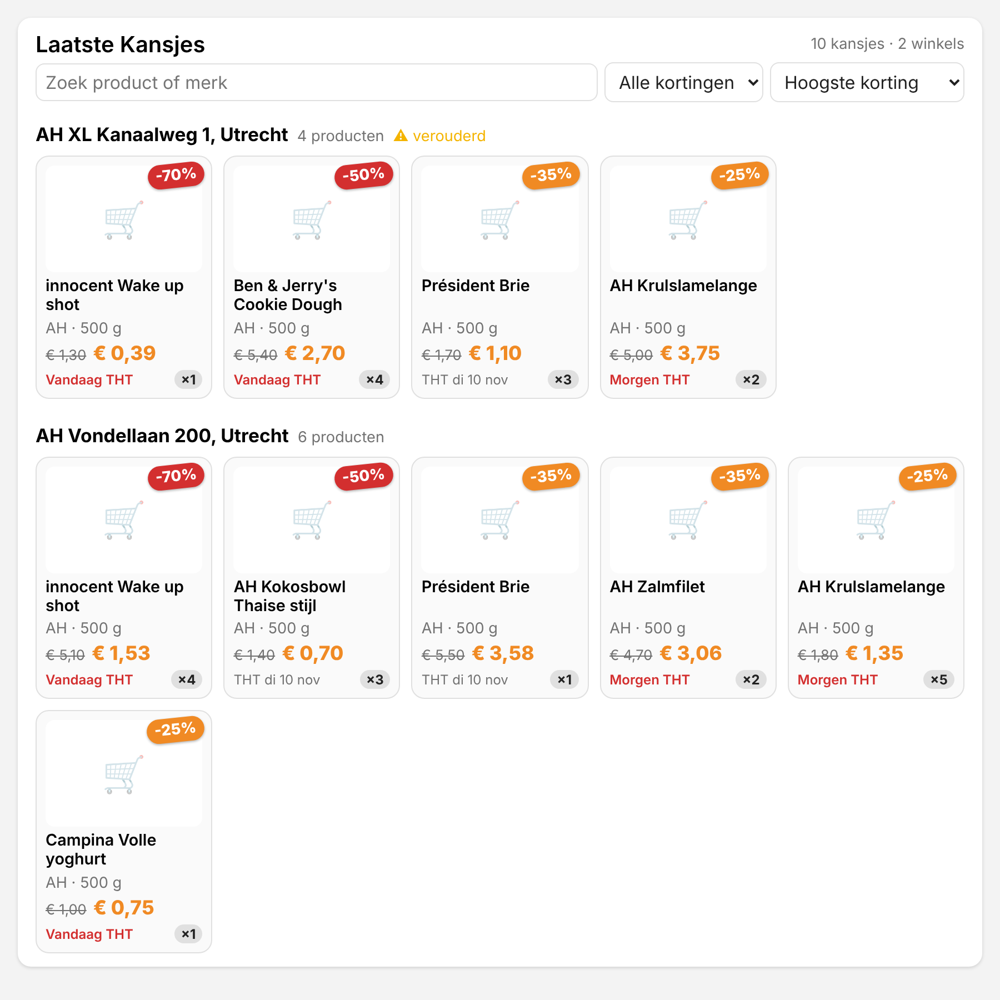

# 🏠 AH Laatste Kans voor Home Assistant

Een custom integration die de **Albert Heijn Laatste Kans**-stickers van je winkels in Home Assistant zet,
met een eigen dashboard-card.

> ⚠️ Onofficieel: de integratie gebruikt de niet-openbare API van de AH-app. AH kan die op elk moment wijzigen.



## Wat je krijgt

| Entiteit | State | Attributen |
|---|---|---|
| `sensor.ah_<straat>_<nr>_<plaats>_laatste_kans` (één per winkel, elk een eigen apparaat) | aantal producten | `items` (titel, merk, prijs, oude prijs, korting, voorraad, THT, plaatje, link), `best_discount`, `categories`, adres |
| `sensor.ah_laatste_kans_laatste_kans_totaal` | totaal over alle winkels | `top`: de 10 beste deals |
| `sensor.ah_laatste_kans_laatste_kans_volglijst` | aantal treffers op je volglijst | `keywords`, `matches` |

En een **event** `ah_laatste_kans_new_bargain` voor elk product dat er sinds de vorige update bij is gekomen.

**Waarom één sensor per winkel (en niet per product)?** Laatste Kans-producten wisselen dagelijks. Sensoren per
product zouden steeds verschijnen en verdwijnen en je entity-register vervuilen. Eén sensor per winkel heeft een
stabiele naam, en de productlijst staat in een attribuut. Die lijst is al snel groter dan de 16 KB die de recorder
wil opslaan (60 producten ≈ 21 KB). Daarom is hij uitgesloten van de geschiedenis. De live state, en dus je
dashboard, heeft de complete lijst gewoon. De state (het aantal) wordt wél bewaard, dus je kunt grafieken maken.

## Installeren

### Via HACS (aanbevolen)
1. HACS › ⋮ › **Aangepaste repositories** → `https://github.com/poudenes/AH-Laatste-kansjes-Home-Assistant-Integration`, type **Integratie**.
2. Zoek **AH Laatste Kans** in HACS en klik op **Downloaden**.
3. Herstart Home Assistant.
4. **Instellingen › Apparaten en diensten › Integratie toevoegen › AH Laatste Kans.**

HACS meldt ook nieuwe versies, zodra er een release met een versienummer (bijvoorbeeld `v0.1.0`) op GitHub staat.

### Handmatig
1. Kopieer de map `custom_components/ah_laatste_kans` naar `/config/custom_components/` op je HA. Bijvoorbeeld:
   - **Finder (Samba-add-on):** ⌘K → `smb://homeassistant.local/config` → sleep de map in `custom_components`.
   - **Terminal (SSH-add-on):**
     `scp -r custom_components/ah_laatste_kans root@homeassistant.local:/config/custom_components/`
2. Herstart Home Assistant.
3. **Instellingen › Apparaten en diensten › Integratie toevoegen › AH Laatste Kans.**

## Inloggen (geen wachtwoord in HA)

De loginpagina van AH gebruikt reCAPTCHA en een 6-cijferige code. Daarom vraagt HA **niet** om je wachtwoord. Je
logt in op AH's eigen pagina, en HA krijgt alleen de eenmalige code die AH aan het eind teruggeeft. Daarna ververst
HA zijn token zelf. Je logt alleen opnieuw in als AH de sessie ooit intrekt; HA vraagt daar dan zelf om.

**Makkelijkst, met de [Mac-app](https://github.com/poudenes/claude):** menu **Kansjes › Code voor Home Assistant…** → log in → de code staat al op je
klembord → plak hem in HA. Doe dat binnen een minuut, want de code verloopt snel.

**Zonder Mac-app:**
1. Open op je computer de ontwikkelaarstools van je browser (F12, of ⌥⌘I) op het tabblad *Console*.
2. Klik in de HA-stap op de link naar de AH-loginpagina, log in en vul de 6 cijfers in.
3. De pagina probeert daarna `appie://login-exit?code=…` te openen. Kopieer die regel uit de console (Safari of
   Firefox: tabblad *Netwerk*, laatste verzoek) en plak hem in HA.

Daarna vul je je **postcode** in en vink je de **winkels** aan.

## Achteraf aanpassen

**Integratie › Configureren:**
- **Winkels aan- of uitzetten:** uitgevinkte winkels verdwijnen met hun apparaat en sensor.
- **Winkels zoeken bij een (andere) postcode:** de nieuwe winkels komen erbij in de lijst.
- **Verversen en volglijst:** interval (minimaal 15 minuten) en zoekwoorden, gescheiden door komma's.

## De card

De card wordt automatisch geladen. Voeg hem toe via *Dashboard › Kaart toevoegen › AH Laatste Kans*, of in YAML:

```yaml
type: custom:ah-laatste-kans-card
# alles optioneel:
title: Laatste Kansjes
entities:                 # standaard: alle winkels van de integratie
  - sensor.ah_vondellaan_200_utrecht_laatste_kans
min_discount: 35          # alleen ≥ 35% korting
sort: discount            # discount | saving | price | expiry | name
group_by_store: true      # false = één grid over alle winkels
max_items: 12             # per winkel, 0 = alles
show_images: true
show_controls: true       # zoekveld, min. korting en sorteren in de card
```

Klik op een product om het op ah.nl te openen.

## Pushmelding bij een kansje op je volglijst

```yaml
alias: Kansje op volglijst
triggers:
  - trigger: event
    event_type: ah_laatste_kans_new_bargain
    event_data:
      watched: true
actions:
  - action: notify.mobile_app_iphone   # jouw telefoon
    data:
      title: "🛒 {{ trigger.event.data.title }} -{{ trigger.event.data.discount }}%"
      message: >-
        € {{ trigger.event.data.was }} → € {{ trigger.event.data.price }}
        bij {{ trigger.event.data.store }} (×{{ trigger.event.data.stock }})
      data:
        image: "{{ trigger.event.data.image }}"
        url: "{{ trigger.event.data.url }}"
```

Zonder het filter `watched: true` krijg je een melding voor élk nieuw product. Dat is leuk voor één winkel, maar
wel veel. 😄

## Ontwikkelen en testen

```bash
python3.13 -m venv .venv && source .venv/bin/activate
pip install -r requirements_test.txt
pytest            # 20 tests: config flow, sensoren, opties, events, reauth, HTTP-laag
```

Bij elke push controleert GitHub Actions de integratie met **hassfest** (de officiële HA-checks), de
**HACS-validatie** en de tests.

## Nieuwe versie uitbrengen
1. Verhoog `version` in `custom_components/ah_laatste_kans/manifest.json` (en `VERSION` in `const.py`).
2. Maak op GitHub een release met tag `v<versie>`. HACS ziet hem vanzelf.

## Verwant
- [Laatstekansjes voor macOS](https://github.com/poudenes/claude): de Mac-app, met *Code voor Home Assistant…*.
- Hoe de AH-endpoints werken, is gebaseerd op [gwillem/appie-go](https://github.com/gwillem/appie-go). Er is geen code overgenomen.
